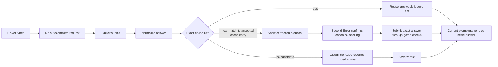

# Skyllion Search Engine Audit

Audit and measurements: 2026-11-18. This report separates live measurements, synthetic measurements, and unmeasured behavior.

## Executive Summary

The original game had no autocomplete. A local autocomplete prototype was evaluated and removed: the final UI does not reveal likely answers while typing. A spelling near-match is offered only after an explicit submit, and must be confirmed with a second Enter before it can land.

The live cache is small: 301 judgments total, 200 accepted, and at most 18 rows for one prompt. A remote search service, FST, trigram index, or worker is not justified by these data. The prototype benchmark below is retained as a reproducible experiment, but its index is not imported by the game.

The live submit path reuses exact prompt-scoped cache hits. A fuzzy hit on a previously accepted answer returns a correction proposal without landing; confirming submits the corrected canonical spelling through the normal prompt/game checks. A miss without a candidate goes to the judge as typed.

## Existing Pipeline and Baseline

1. The input's `onChange` updates local component state; there was no per-keystroke search or request.
2. Submit posts `{ promptId, answer }` to `/api/judge`, or to the room action route for Dogfight.
3. `lib/judge.js` applies `NFKC`, lowercase, whitespace collapse, and boundary-punctuation trimming.
4. `rule()` queries `judgments` for an exact match or a bounded Levenshtein candidate among accepted rows for the same prompt. The primary key is `(prompt_id, answer)`.
5. Exact cache hits return the previously saved tier. A fuzzy hit returns only a correction proposal; a second Enter submits the canonical answer exactly. A miss calls Cloudflare Workers AI and saves the verdict asynchronously. Room and solo routes validate the confirmed answer against current game state.
6. There was no fixed answer catalogue or alias table. `judgments` is both the answer history and the cache, and includes grounded rows as well as accepted rows.

The repo has 82 hand-authored prompts. At measurement time `judgments` held 301 rows, of which 200 had a non-null tier. The largest per-prompt count was 18 (15 accepted). No Cloudflare model call was made for profiling; model latency and inference cost are therefore not measured.

### Live PostgreSQL and API Baseline

Thirty serial requests per case were measured from the local Node process using the configured Neon connection. Timings include the client/server round trip, not just PostgreSQL execution time. The high maximums are single observations and should not be treated as stable tail estimates.

| Path | p50 | p95 | Max | Corpus / condition |
|---|---:|---:|---:|---|
| Existing exact judgment query | 55.61 ms | 82.91 ms | 446.17 ms | 30 repeated requests, `spc09` |
| Fuzzy cache candidate lookup | 56.13 ms | 64.47 ms | 529.31 ms | 30 repeated requests, same prompt |
| Autocomplete snapshot prototype (removed) | 62.01 ms | 72.09 ms | 462.17 ms | 30 repeated requests, at most 18 rows |

The fuzzy query was measured before the confirmation flow was restored; its SQL shape is unchanged. The snapshot endpoint was removed. The measurements show the remote round trip dominates this small-corpus workload. No full user-perceived baseline existed before the autocomplete prototype.

## Research and Alternatives

Complexity is indicative; actual cost depends on key lengths, branching, candidate distribution, and result count. `N` is entity count, `L` is string length, and `K` is returned results.

| Technique | Mechanism and typical cost | Build / memory / query trade-off | Suitability here |
|---|---|---|---|
| Hash map | Exact key to entity; average O(1) lookup | O(N) construction and storage; collisions must retain multiple entities | Appropriate for exact normalized keys, but not prefixes or typo recovery |
| Trie / radix tree | Traverse characters; compressed radix edges merge single-child paths. Lookup O(L), enumeration O(L + K) | O(total key characters) nodes/edges; build O(total characters); radix reduces pointer/node overhead | Strong prefix primitive; a plain object graph is sufficient at current scale, but our sorted range is smaller in code |
| Sorted prefix range | Binary lower-bound on sorted keys, then enumerate matching range; O(log N + K) for phrase prefixes | O(N log N) build, compact contiguous array, low query allocation | Selected for whole-answer prefixes; predictable and fast for the current snapshot |
| Token-prefix postings | Map each token prefix to candidate IDs; multi-token queries intersect postings | Build/storage proportional to the sum of token-prefix lengths; broad multi-token postings can cost O(N) | Selected for ordered multiword partial input such as `new yor`; bounded snapshot limits the intersection cost |
| FST | Finite-state transducer shares common paths/suffixes and can attach outputs; prefix traversal follows automaton arcs | Compact for static large dictionaries, but build and update flow are more complex; practical query walks query states and output paths | Not justified for a live cache of at most 1,000 entries. Revisit for a large mostly-static catalogue |
| Inverted index | Token or n-gram to document posting lists; intersect/union lists at query time | O(total indexed terms/postings) memory and build work; query depends on posting-list frequency | Useful for large corpora and arbitrary token order; more infrastructure than this prompt-local cache needs |
| Edge n-grams | Emit every token prefix at index time | Fast prefix lookup but index size grows with token lengths and configured gram bounds; truncation can miss long inputs | Useful at search-engine scale; our map postings use the same prefix idea only for the small loaded snapshot |
| Incremental prefix search / cache | Reuse a previous query's candidate set or cache normalized query results | Low build cost; cache invalidation and backspacing/prefix edits add complexity | Not needed yet: local indexed searches are microseconds and the index is reused for the prompt |
| Levenshtein | Insert/delete/substitute dynamic program, O(mn) per pair; no adjacent-transposition single edit | No index required; scanning a dictionary is O(Nmn) | Already used by PostgreSQL for submit-time cache correction; acceptable for 18 rows, not a large dictionary scan |
| Damerau-Levenshtein / OSA | Damerau counts adjacent transposition; OSA is a restricted recurrence and counts a local swap as one edit | Similar per-pair DP cost; OSA is not a general metric, which matters for metric-tree pruning | Better correction semantics for `teh`/`the`; not added without a quality corpus and a candidate retrieval requirement |
| Bitap / Fuse.js | Bit-parallel approximate pattern matching; Fuse uses modified Bitap and a 32-character term limit | Simple library integration; searches each record's fields and combines fuzziness/location/field scoring | Good for small general fuzzy lists, but its blended score/location rules are less transparent than this game's precision-first prefixes |
| SymSpell | Precompute symmetric delete forms; generate query deletes and use a hash index to find near terms | Fast query candidate generation; index size/build can grow with vocabulary, term length, and edit radius; needs useful term frequencies | Attractive for a large static spelling dictionary; unnecessary for the current per-prompt accepted cache and does not create missing aliases |
| BK-tree | Metric tree prunes subtrees using the triangle inequality and edit-distance radius | Usually sublinear when data/tree geometry is favorable, worst case O(N); inserts/queries calculate edit distances | Possible dictionary candidate index, but behavior depends on balance/radius and OSA cannot safely be substituted as a metric without care |
| Trigrams / `pg_trgm` | Overlapping character 3-grams provide similarity; PostgreSQL GIN/GiST indexes prune candidates | Index adds storage and migration cost; threshold tuning; short inputs are weak; prefix semantics are separate | Keep as a future DB-side option if per-prompt rows grow substantially; current corpus does not support a meaningful benchmark |
| Weighted edit distance | Dynamic program assigns different costs to substitutions/insertions/deletions (for example keyboard-neighbor errors) | O(mn) pairwise work; weights require labeled errors and language/device policy | Not justified without typo telemetry; incorrect weights can create confident false positives |
| Token / compound matching | Compare token coverage/order; splitting and joining can be modeled as token-level candidates or DP segmentation | Candidate generation and segmentation cost depend on vocabulary and maximum token count | Ordered token-prefix matching is used for suggestions; whitespace-free correction stays with submit-time logic until a curated corpus exists |

### Production Implementations Consulted

- [Elasticsearch `search_as_you_type`](https://www.elastic.co/docs/reference/elasticsearch/mapping-reference/search-as-you-type) creates shingle subfields and an `_index_prefix` edge-ngram subfield. `bool_prefix` ranks ordered shingles while allowing term order variation. More shingle sizes increase index size. The [edge-ngram documentation](https://www.elastic.co/docs/reference/text-analysis/analysis-edgengram-tokenizer) warns that `max_gram` limits searchable term length and that truncation can add irrelevant results.
- [Meilisearch typo-tolerance internals](https://github.com/meilisearch/documentation/blob/main/resources/internals/typo_tolerance.mdx) describe a term FST intersected with a query Levenshtein automaton, Damerau transpositions, short-word thresholds, first-character penalties, strict typo ranking, and split/join candidates. This is a useful precision model, not a dependency recommendation.
- [Typesense 29.0 search documentation](https://typesense.org/docs/29.0/api/search.html) exposes last-token prefixes, Damerau-Levenshtein typo counts, minimum word lengths, split/join fallback, candidate limits, and exact-match prioritization. Its bounded candidate generation is useful at much larger scale.
- PostgreSQL [pg_trgm](https://www.postgresql.org/docs/current/pgtrgm.html) supports indexed trigram similarity and `LIKE`/`ILIKE` operations with GIN/GiST. Its documentation notes that more query trigrams improve pruning and that GiST supports efficient nearest-distance ordering where GIN does not.
- PostgreSQL [fuzzystrmatch](https://www.postgresql.org/docs/current/fuzzystrmatch.html) documents `levenshtein()`'s 255-character input limit and `levenshtein_less_equal()` for bounded-distance queries. The current app caps input at 80 characters.
- [Fuse.js fuzzy search](https://www.fusejs.io/fuzzy-search.html) documents its modified Bitap implementation, scoring factors, location window, and optional diacritic handling.
- [SymSpell](https://github.com/wolfgarbe/SymSpell) documents symmetric-delete candidate lookup, compound splitting/joining, frequency-based ranking, and the trade-off between edit radius, preprocessing, and index size. Its performance claims are project benchmarks, not measurements on Skyllion's data.
- Apache Lucene's [10.3.1 FST API](https://lucene.apache.org/core/10_3_1/core/org/apache/lucene/util/fst/FST.html) describes a compact byte-array finite-state representation and arc lookup. Lucene is a sound reference for static compressed indexes, but its machinery is disproportionate here.
- The BK-tree comparison is based on the original Burkhard-Keller metric-tree approach and its triangle-inequality pruning; observed performance is data- and radius-dependent, with linear worst cases.

## Final Gameplay Pipeline

The final UI does not fetch or display likely answers. The local search module and benchmark remain isolated from app imports so the measured experiment is reproducible without affecting gameplay. The former snapshot endpoint and its partial database index were removed; no database migration is needed for this change.

Only prompt-scoped accepted cache rows can be correction candidates. The query checks the two nearest accepted rows and proposes a correction only when the best edit distance is unique; tied candidates fall through to the judge instead of being broken by popularity. A correction never lands on the first submit: the UI keeps the original text, displays one canonical spelling, and requires another Enter. Editing the input dismisses the proposal. The confirmed canonical text is then sent through the ordinary exact-cache/game-phase path.

## Synthetic Benchmark and Accuracy

Command: `npm run benchmark:search`. Runtime was Node v25.2.1 on Windows x64. Each search p95 below is over 300 synchronous calls. A selective query targets one generated entity; a broad query is the two-character prefix `en`. The linear comparator scans pre-normalized answer keys. This benchmarks the isolated, unshipped autocomplete prototype, not final gameplay.

| Entries | Index build | Observed heap delta | Indexed selective p95 | Indexed broad p95 | Linear selective p95 | Linear broad p95 |
|---:|---:|---:|---:|---:|---:|---:|
| 1,000 | 9.58 ms | 1.17 MB | 3.0 µs | 2.8 µs | 27.8 µs | 16.3 µs |
| 10,000 | 22.65 ms | 11.44 MB | 5.6 µs | 1.9 µs | 243.8 µs | 210.2 µs |
| 100,000 | 252.89 ms | 122.97 MB | 6.2 µs | 1.3 µs | 3,234.8 µs | 1,495.2 µs |

The benchmark is synthetic and single-process. Heap delta is a noisy `heapUsed` difference without forced GC; it is not retained-size accounting. The 100k selective query is highly selective and does not describe every multi-token posting intersection. The final app has no downloaded snapshot; these are prototype measurements only. Cold-start, server throughput/concurrency, and final input-to-visible percentiles were not measured.

The benchmark's tiny five-query golden fixture reported Top-1 1.000, Precision@6 1.000, and MRR 1.000 (four relevant queries and one negative no-result query). These are smoke-test numbers only, not a representative accuracy evaluation. Unit checks cover partial canonical names, multiword prefixes, a diacritic variant, short/empty/no-result queries, deterministic top-K, and the expected suggestions. The prototype browser check confirmed option selection did not auto-submit. This UI has since been removed.

Historical prototype input-to-visible browser timing used a mocked response: the first result took 121 ms; three warm interactions took 7, 10, and 57 ms. These are single Playwright wall-clock samples including browser automation overhead, not production p50/p95. The prototype made one snapshot request across four keystrokes. Its endpoint measured p50 62.01 ms and p95 72.09 ms against the current Neon connection before it was removed.

## Validation and Limitations

- `npm test`: passed, including the added search cases.
- `npm run benchmark:search`: passed at 1k, 10k, and 100k synthetic entries.
- Final `npm run build`: passed; Next.js compiled, linted, and generated static pages with no suggestion route.
- The removed prototype's live API and mocked browser interactions were verified before removal.
- Correction confirmation browser test: first Enter preserved the typed misspelling and showed one correction with no landing; second Enter changed the input to the canonical spelling and landed after the second request.
- Live judge check: prompt `geo12`, input `brazilia` returned `suggest: "brazil"` with no tier; submitting `brazil` returned the cached tier.
- No Cloudflare model request, database migration, or full answer-accuracy study was run.

Exact prompt-scoped cache hits are still reused, so an exact repeat can resolve immediately. Stored Paper Plane results are consistent with the current tier mapping: the 18 cached Paper rows have average validity 0.991 and rarity from 0.082 to 0.624, below the 0.65 Paper cutoff. Without a specific prompt and answer, this aggregate cannot determine whether any individual answer was misjudged. Near-matches now require explicit confirmation before they can use the cached tier.

Alias resolution is not implemented because no verified canonical entity/alias source exists. Keep any future suggestions separate from answer acceptance and require explicit confirmation before a correction can land. Do not silently use popularity or semantic similarity as proof that an answer is valid.